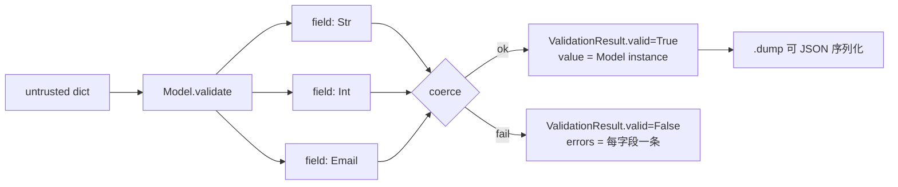

<p align="center">
  <em>Validate untrusted payloads, collect every error at once, coerce loose types — no dependencies.</em>
</p>

<p align="center">
  
  
  
</p>

---

Every backend receives data it does not control: request bodies, webhook callbacks,
uploaded config, rows scraped from someone else's page. Hand-rolled
`if "email" in body and isinstance(body["email"], str)` checks rot fast, stop at the
first problem, and tell the caller nothing useful.

Slate describes the shape once, as a class, and reports **all** problems at once.

## Quick start

```python
from slate import Model, Str, Int, Email

class User(Model):
    name  = Str(min_len=2)      # Field instances, not type annotations
    age   = Int()
    email = Email()

user = User.parse({"name": "ada", "age": "36", "email": "ada@example.com"})
print(user.name, user.age, type(user.age).__name__)
# ada 36 int        <- "36" was coerced
print(user.dump())
# {'name': 'ada', 'age': 36, 'email': 'ada@example.com'}
```

`parse()` raises on failure. `validate()` never raises — it returns a result you can
inspect, and it collects every error rather than stopping at the first:

```python
r = User.validate({"name": "x", "age": "nope", "email": "not-an-email"})
print(r.valid)          # False
for e in r.errors:
    print(f"{e.path}: {e.message}")
```

```text
name: length 1 is less than minimum 2
age: not a valid integer
email: string does not match pattern ^[^@\s]+@[^@\s]+\.[^@\s]+$
```

**Three errors, one pass.** A form can highlight every bad field instead of making
the user fix them one reload at a time.

## Field types

| Scalars | Containers |
|---|---|
| `Str` `Int` `Float` `Bool` `Const` `Any` `Nil` | `List` `Dict` `Tuple` |
| `Enum` `DateTime` `Email` | `Optional` `Union` `Nested` |

`Nested(OtherModel)` validates an embedded mapping and rewrites the error path, so
`address.zip` reports as `address.zip`, not `zip`.

## Validation without a class

```python
from slate import TypeAdapter, Int, List

TypeAdapter(Int()).parse("42")        # 42
TypeAdapter(List(int)).parse(["1", "2"])   # [1, 2]
TypeAdapter(Int()).validate("x").valid     # False
```

## What "declarative" buys you



Every field is checked independently, so one bad value does not hide the others.

## Install

Drop the `slate/` folder into your project. No `pip install`, no supply chain.

## Tests

```bash
python -m pytest -q
```

## Limitations

- **Coercion is lenient by design, and that is a policy decision.** `"36"` becomes
  `36`; `"yes"` becomes `True`. If you need strict typing, tighten individual fields
  — the default favours accepting messy real-world input over rejecting it.
- **No JSON Schema export.** The grammar is Python-side only; `schema()` describes
  field shapes for debugging, not a portable contract.
- **No async or streaming validation.** It validates a whole object in memory.
- **Performance is not benchmarked.** No throughput numbers are published here,
  because none were measured.

## License

MIT
